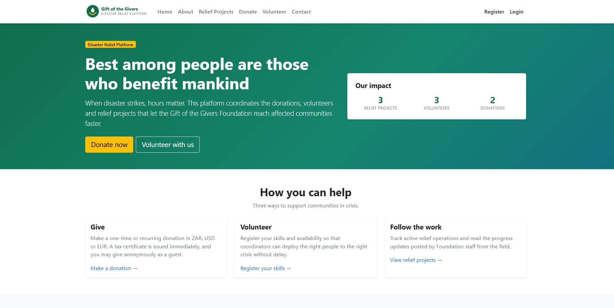
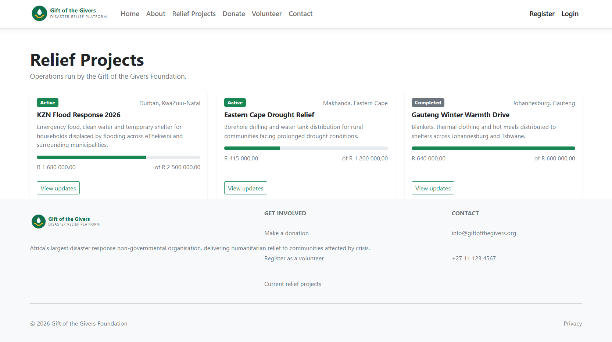
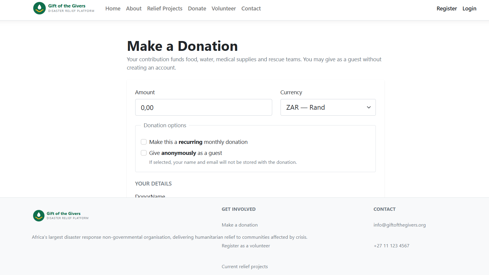

# Gift of the Givers Website

[](https://github.com/OlugaNels/gift-of-the-givers/actions/workflows/dotnet-build.yml)

ASP.NET Core MVC web application (.NET 8) for managing donations, relief projects and volunteers, with employee and volunteer accounts.

Module: APPR6312.

## Screenshots

| Home | Relief projects | Make a donation |
|---|---|---|
|  |  |  |

## Features

- Donations, relief projects, project updates and volunteer sign-up (controllers, view models and Razor views for each)
- Employee area for managing the above
- Authentication and roles with ASP.NET Core Identity
- SQL Server database through Entity Framework Core, with migrations in `GiftOfTheGivers.Website/Data/Migrations`

## Tech

C#, ASP.NET Core MVC (net8.0), Entity Framework Core (SQL Server), ASP.NET Core Identity, Razor, Bootstrap.

## Run it locally

No secrets are stored in source control. Supply them at runtime:

```bash
cd GiftOfTheGivers.Website
dotnet user-secrets set "ConnectionStrings:DefaultConnection" "<your SQL Server connection string>"
dotnet user-secrets set "SeedEmployee:Email" "<employee email>"
dotnet user-secrets set "SeedEmployee:Password" "<employee password>"
dotnet ef database update
dotnet run
```

On Azure App Service, set the same values as the `DefaultConnection` connection string and the `SeedEmployee__Email` / `SeedEmployee__Password` application settings.
